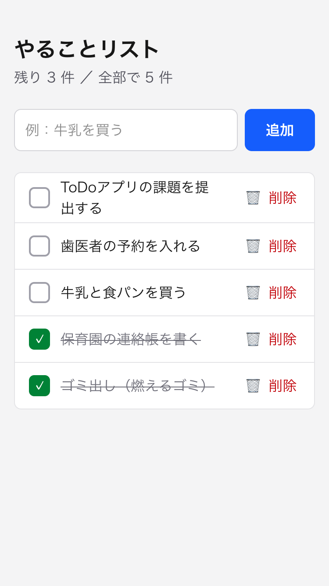
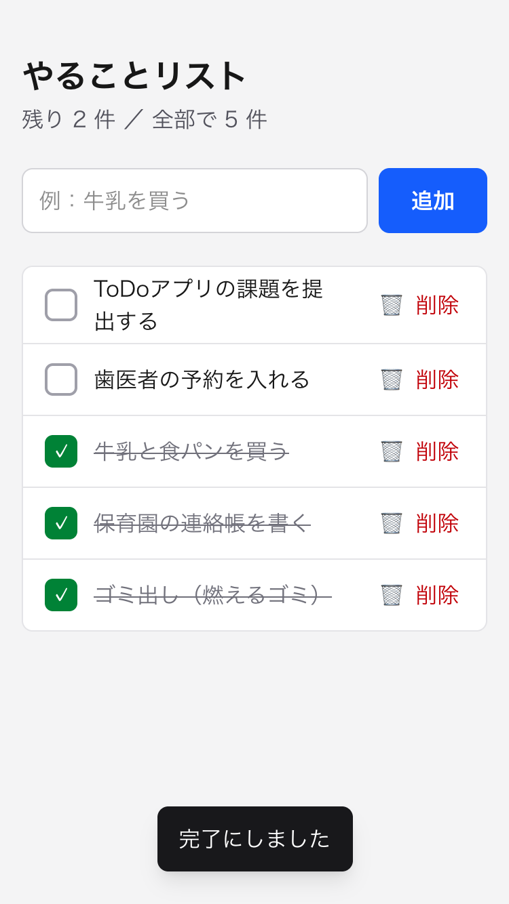
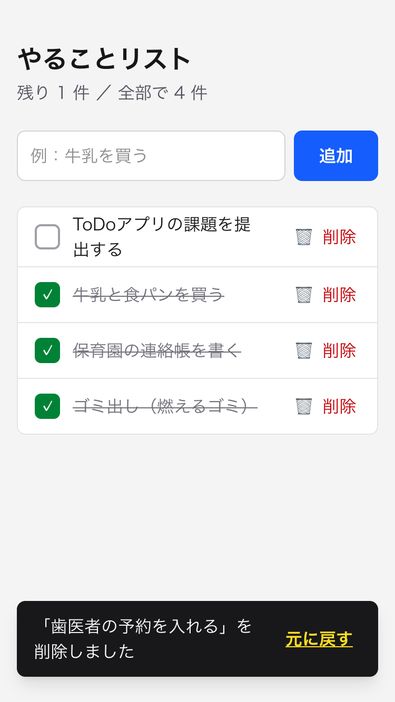
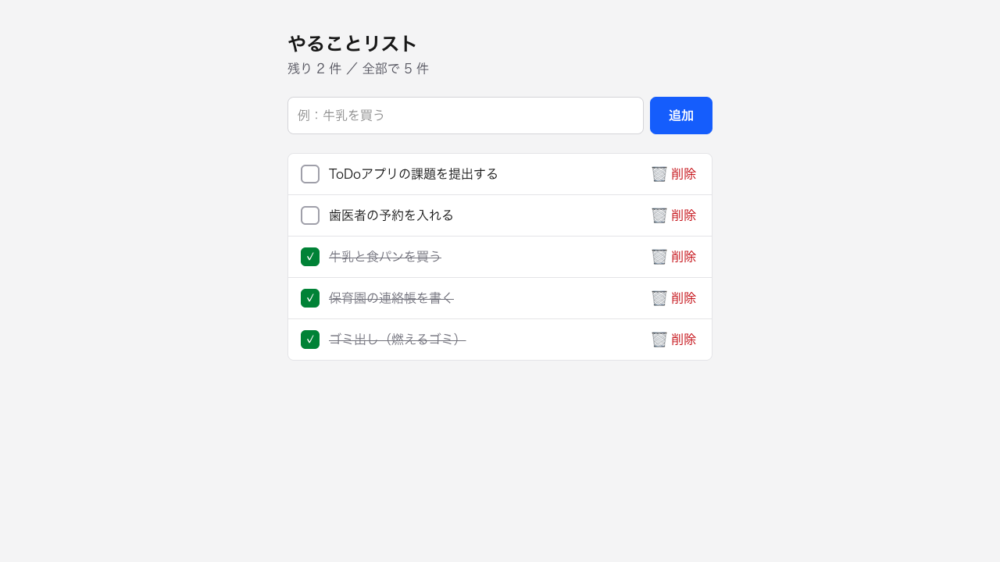
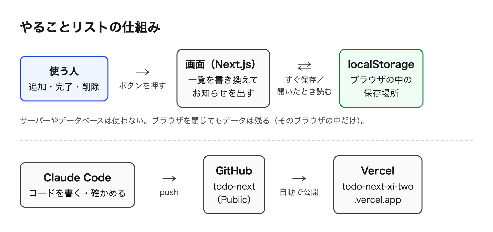

# [課題提出] Claude Code で作る ToDo リスト Web アプリの実装課題を完成させました

> このファイルは提出記事の原稿です（`zsh docs/copy_article.sh` で写真ごとコピーできます）。

## A. 課題概要

### 課題情報

- 課題名：実践編 課題1-0-1　Claude Code を使って、JavaScript（Next.js など）で ToDo リスト Web アプリを作成しよう
- 難易度：★★☆☆☆（5段階で自己評価）

### 課題要件

- タスクの追加・完了マーク・削除ができる
- ブラウザを閉じてもデータが残る
- UI/UX 5つの落とし穴（6-2）を意識して、読みやすく操作しやすい形にする
- GitHub にリポジトリを作り、Vercel にデプロイして公開URLを出す
- Bolt.new ではなく、Cursor ＋ Claude Code を使ってゼロから組み立てる

### ソースコード

- GitHub：https://github.com/Usuke3122378/todo-next
- Google Drive：なし
- 公開URL：https://todo-next-xi-two.vercel.app

### 成果物のスクリーンショット

メイン画面（スマホ）。上に「残り○件／全部で○件」、完了したタスクには✓と取り消し線が付く

完了にしたところ。画面の下に「完了にしました」とお知らせが出る

削除したところ。お知らせに「元に戻す」ボタンが付き、押すと元の位置に戻る

ブラウザを完全に閉じて開き直した画面（PC）。タスクが残っている

## B. 実装内容

### 使用技術

- 言語：TypeScript
- フレームワーク：Next.js（App Router）、React、Tailwind CSS
- データベース：なし（タスクはブラウザの中の保存場所 localStorage に保存）
- その他ツール：Cursor（開発の母艦。Claude Code を動かしながらファイルを確認）、Claude Code（作成・動作確認）、GitHub（コード保管）、GitHub CLI（gh。リポジトリ作成と push）、Vercel（公開。push すると自動で公開し直す）

### 実装した機能

1. タスクの追加：入力欄に書いて「追加」ボタンか Enter で追加。新しいものが一番上に並ぶ。空のまま押すと「やることを入力してください」と案内する
2. 完了マーク：タスクの行を押すと完了（✓と取り消し線）、もう一度押すと未完了に戻る。上の「残り○件」も変わる
3. 削除：「🗑 削除」で消す。8秒間は「元に戻す」で元の位置に戻せる
4. データの保存：追加・完了・削除のたびに localStorage に保存し、開いたときに読み込む。再読み込みしても、ブラウザを閉じて開き直しても残る

### 工夫したポイント

UI/UX 5つの落とし穴を、1つずつ対策しました。

- 項目が多すぎてゴチャゴチャ：入力欄・追加ボタン・一覧だけにしました。期日やカテゴリは付けていません。入力は100文字までにして、一覧が縦に伸びすぎないようにしました。
- ラベルが専門用語：「追加」「削除」「元に戻す」「残り○件」など、ふだん使う言葉にしました。
- クリックしても無反応に見える：操作するたびに、画面の下に「追加しました」「完了にしました」などのお知らせを出します。保存データを読み込むあいだは、くるくるマークと「読み込み中…」を表示します。
- スマホで文字が小さい：文字はすべて16px以上、ボタンはすべて高さ44px以上にしました。実際にスマホ幅（375px）で表示して、Claude Code に大きさを測ってもらって確かめました。
- 色だけで区別：完了は緑色だけでなく「✓の形」と「取り消し線」でも、削除は赤色だけでなく「🗑」と「削除」の文字でも区別できるようにしました。

ほかにも、次のことを工夫しました。

- 削除は確認の画面を出さずにすぐ消し、そのかわり「元に戻す」を付けました。毎回「本当に消しますか？」と聞かれる手間を減らしつつ、まちがえて消しても戻せます。
- 保存方法は、無料でサーバーもいらない localStorage にしました。保存できない設定のブラウザでは「保存できませんでした」と知らせます。

## C. 実装過程

### 開発の流れ

#### 10月23日　プロジェクトを作る

やったこと：Claude Code に、Next.js（App Router、TypeScript、Tailwind CSS）のプロジェクトを作ってもらった。ほかの課題と混ざらないように、新しいフォルダ todo-next にした。

遭遇したエラー：`（エラーはなし）`

Cursorに聞いた内容：（今回は Claude Code に相談）課題文を貼り付けて「ステップバイステップで教えて」と頼んだ。

Cursorの回答：（Claude Code の回答）①プロジェクト作成 ②画面と機能 ③データの保存 ④UI/UXの見直し ⑤GitHub ⑥Vercel ⑦提出、の7ステップで進める。保存はブラウザの localStorage を使えば、無料でサーバーもいらない。

実際に試したこと：

1. create-next-app でプロジェクトを作った
    - 結果：Next.js のひな形ができ、Git の最初の記録（コミット）まで作られた

学んだこと：作業の前に全体の流れを出してもらうと、今どこにいるのかがわかりやすい。

---

#### 10月24日（1）画面と機能（追加・完了・削除）を作る

やったこと：講座 6-2 の「UI/UX 5つの落とし穴」を Claude Code に貼り付けて、最初からそれを意識した画面を作ってもらった。

遭遇したエラー：`（エラーはなし）`

Cursorに聞いた内容：（Claude Code に相談）5つの落とし穴の内容を伝えた。

Cursorの回答：（Claude Code の回答）入力欄・追加ボタン・一覧だけの画面にする。操作するたびにお知らせを出し、完了は✓と取り消し線でも見分けられるようにする。削除には「元に戻す」を付ける。

実際に試したこと：

1. Claude Code が見えないブラウザ（headless Chrome）を自動で動かして、追加・完了・削除・元に戻すを試した
    - 結果：すべて動いた。ボタンの高さも測って、すべて44px以上だった
    - 注意：この時点では、再読み込みするとタスクが消える（まだ保存していないため）

学んだこと：`"use client"` と書いたファイルはブラウザ側で動き、ボタンを押したときの動きを書ける。

---

#### 10月24日（2）データを保存したら lint に注意された

やったこと：localStorage に保存する処理を足した。

遭遇したエラー：`Calling setState synchronously within an effect body causes cascading renders that can hurt performance, and is not recommended.  react-hooks/set-state-in-effect`

Cursorに聞いた内容：（Claude Code が lint の結果を確認）

Cursorの回答：（Claude Code の回答）「画面が表示されたあとに読み込んで書き換える」作りだと、画面がムダに2回描かれると注意されている。アプリの部品をブラウザ側でだけ表示する形（next/dynamic の ssr: false）にして、最初から保存データを読み込む。保存は useEffect ではなく、ボタンを押したときにその場で行う。

実際に試したこと：

1. 読み込み用の部品（todo-loader.tsx）を作り、保存は「一覧を変える関数」の中でまとめて行うように直した
    - 結果：lint のエラーが消えた。読み込みのあいだは、くるくるマークが出るようになった

学んだこと：lint は書き間違いだけでなく、「動くけど良くない書き方」も教えてくれる。

---

#### 10月24日（3）ブラウザを閉じたらデータが消えた？

やったこと：「ブラウザを閉じてもデータが残るか」を、Claude Code に自動テストしてもらった。

遭遇したエラー：`ブラウザを開き直した後: []  まだ何もありません`

Cursorに聞いた内容：（Claude Code がテスト結果を確認）

Cursorの回答：（Claude Code の回答）再読み込みでは残っている。テストのときにブラウザを強制終了していたので、保存がディスクに書き込まれる前に落ちたのが原因と考えられる。ふつうに閉じる方法でテストし直す。

実際に試したこと：

1. テストを「ふつうにブラウザを閉じる」形に変えて、もう一度試した
    - 結果：開き直してもタスクが残った（「残り 1 件 ／ 全部で 2 件」）

学んだこと：テストの失敗は、アプリではなくテストのやり方が原因のこともある。

---

#### 10月24日（4）UI/UX を見直す

やったこと：タスクを10件、長い文や英字だけの文も入れて、スマホ幅（375px）とPC幅（1280px）で点検してもらった。

遭遇したエラー：`（エラーはなし）スマホで、下に出るお知らせが一番下のタスクに重なっていた。✓の文字だけ14pxだった`

Cursorに聞いた内容：（Claude Code に相談）5つの落とし穴を基準に見直してほしいと頼んだ。

Cursorの回答：（Claude Code の回答）一覧の下に余白を足して重ならないようにする。✓も16pxにする。「元に戻す」付きのお知らせは押す時間がいるので8秒出す。入力は100文字までにする。

実際に試したこと：

1. 直したあと、もう一度スマホ幅で撮って確かめた
    - 結果：重なりがなくなり、いちばん小さい文字も16pxになった

学んだこと：短いタスクだけでなく、長い文やたくさんのタスクでも試すと、見落としに気づける。

---

#### 10月24日（5）GitHub と Vercel で公開する

やったこと：GitHub を操作するコマンド（gh）を入れて、Public のリポジトリ todo-next を作り、push した。Vercel で GitHub のリポジトリを読み込んで公開した。

遭遇したエラー：`Permission for this action was denied by the Claude Code auto mode classifier. Reason: [Create Public Surface].`

Cursorに聞いた内容：（Claude Code に「gh を入れて実行して」と頼んだ）

Cursorの回答：（Claude Code の回答）Homebrew が入っていないので、GitHub 公式の配布ファイルをダウンロードして入れる（チェックサムで本物か確認）。ただし Public のリポジトリを作るのは「ネットに公開する操作」なので、Claude Code の安全チェックで止められた。本人がコマンドを実行するか、はっきり許可してほしい。

実際に試したこと：

1. 入力欄に `!` を付けて、自分で `gh repo create todo-next --public --source=. --remote=origin --push` を実行した
    - 結果：リポジトリができて、コードが GitHub に送られた
2. Vercel で todo-next を Import して、設定を変えずに Deploy した
    - 結果：公開URLができた。公開版でも、追加・完了・削除と、閉じても残ることを確認できた

学んだこと：公開する操作は、AI に任せきりにせず、自分で確認してから実行する仕組みになっている。

---

#### 10月24日（6）公開版のスクショで見つけた折り返し

やったこと：提出記事用に、公開URLの画面のスクショを撮った。

遭遇したエラー：`（エラーはなし）スマホ幅で、削除のお知らせの「元に戻す」が2行に折れていた`

Cursorに聞いた内容：（Claude Code がスクショを確認）

Cursorの回答：（Claude Code の回答）「元に戻す」ボタンが文の長さに押されて縮んでいる。縮まない・折り返さない設定（shrink-0、whitespace-nowrap）を付ける。

実際に試したこと：

1. 直して commit・push した
    - 結果：1〜2分で Vercel が自動で公開し直し、「元に戻す」が1行で表示されるようになった

学んだこと：push するだけで公開版も新しくなるので、小さな修正もすぐ反映できる。

---

### 参考にした資料

- 公式ドキュメント：Next.js の「Server and Client Components」（プロジェクト内の node_modules/next/dist/docs）
- 参考記事：
- 動画教材：講座 6-2「UI/UX 5つの落とし穴」

## D. 学習の振り返り

### 今回学んだこと

技術的な学び：

- Next.js の App Router では、ページはふつうサーバー側で作られる。ボタンの動きや localStorage を使う部品には `"use client"` を書く
- localStorage は文字しか保存できないので、一覧は JSON という文字の形に変えて保存し、読むときに戻す
- localStorage はブラウザの中にしかないので、サーバー側で表示しないようにする（next/dynamic の ssr: false）
- GitHub と Vercel をつなぐと、push するたびに自動で公開し直される

AIツールの使い方：

- 課題文と講座の資料（5つの落とし穴）を最初に貼り付けると、それに合わせて作ってもらえる
- 「ステップバイステップで」と頼むと、1つ終わるごとに確認しながら進められる
- 動作確認やスクショ撮影も、Claude Code にブラウザを自動で動かしてもらえる
- 公開する操作は安全チェックで止まるので、内容を確認してから自分で実行する

開発の進め方：

- 機能 → 保存 → 見直し → 公開、と1つずつ進めて、そのたびに commit すると、どこで何をしたかがわかりやすい
- スマホ幅とPC幅の両方で、長い文やたくさんのタスクも入れて試す
- 公開したあとも、公開版でもう一度確認する

### 作った機能からの発展アイデア

今回作った機能：完了したタスクに✓と取り消し線を付け、「残り○件」を表示する機能

発展アイデア：「完了したタスクをまとめて片付けるボタンと、今週いくつ終わったかが見える記録」

- どんな人に：家事・育児・仕事の細かい用事を毎日たくさんメモしている人。とくに、終わったことが見えないと「今日も何もできなかった」と感じてしまう人
- どんな時に：夜、1日の終わりに一覧を見返すとき。週末に、1週間の用事をふり返るとき
- どんなメリットがあるか：完了したタスクを1回でまとめて片付けられるので、一覧がすっきりして、残っている用事だけに集中できる。「今週は12件終わった」のように数で見えるので、がんばった実感が持てて、続ける気持ちにもつながる

### 次の課題に向けて

- localStorage はそのブラウザだけなので、スマホとパソコンで同じ一覧を見られるように、データベースへの保存に挑戦したい
- 今回は Claude Code に動作確認を自動でしてもらったので、次はテストのコードも自分のプロジェクトに入れてみたい
- GitHub の README を日本語で書いて、アプリの説明と使い方を載せたい

---

📝 追加メモ

- タスクはブラウザの中（localStorage）にだけ保存されるので、別の端末やブラウザでは引き継がれません
- APIキーなどの秘密情報は使っていません
- 公開URLは GitHub と連携しているので、push するたびに自動で更新されます
