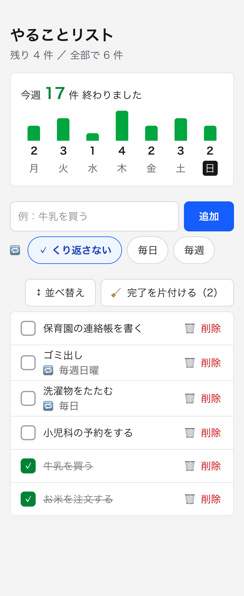
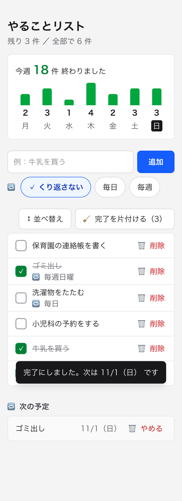
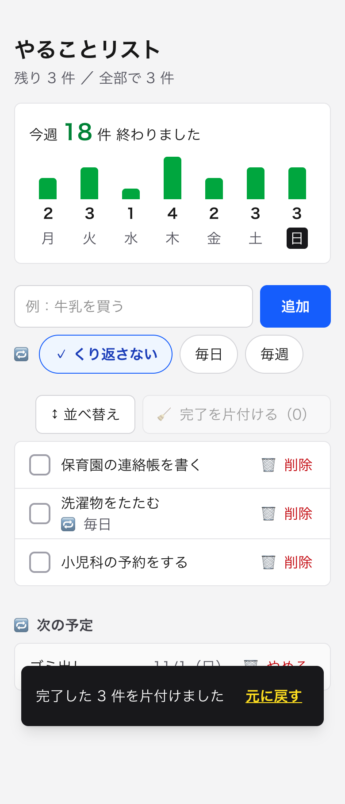
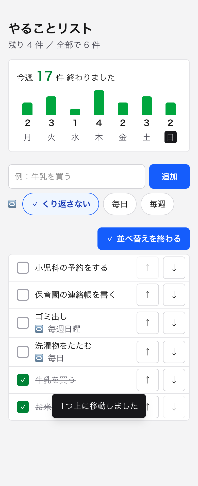
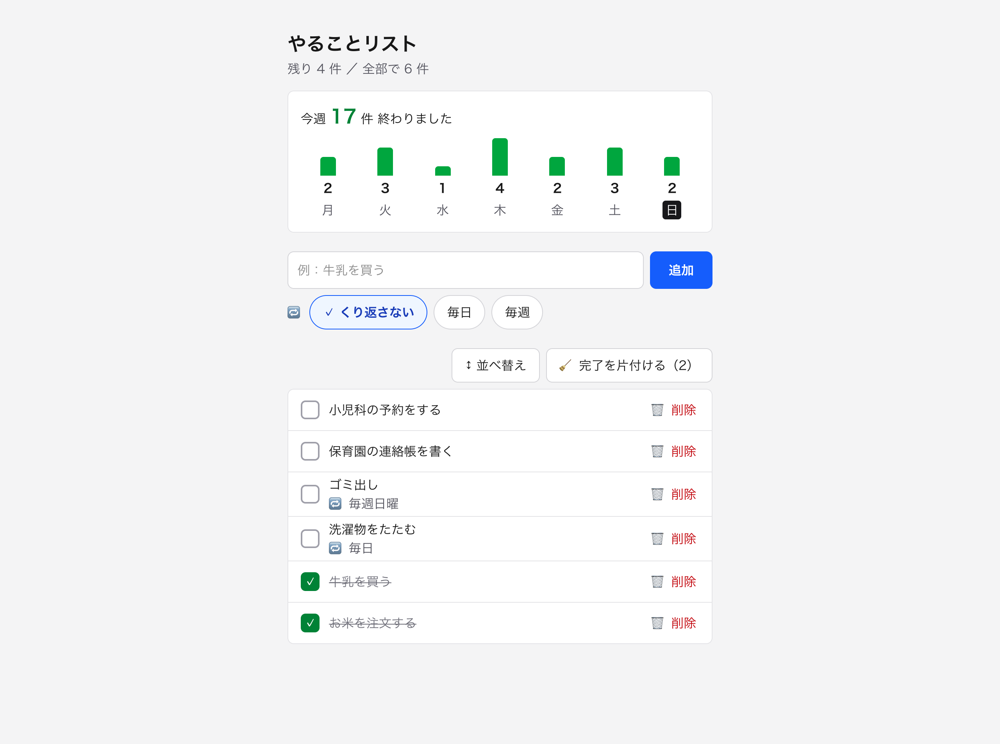
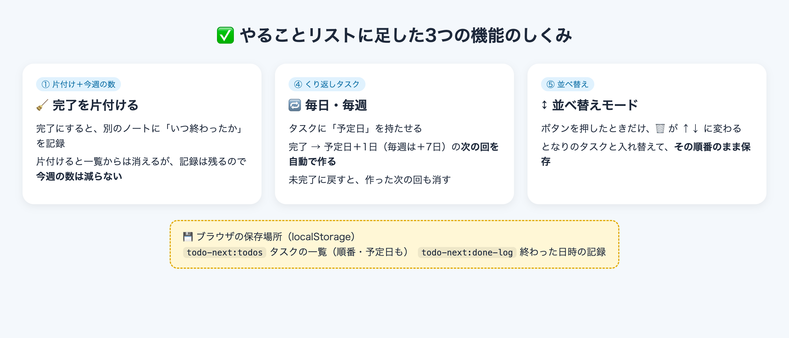

# [課題提出] ToDo アプリに自分で考えた3つの追加機能を実装する課題を完成させました

> このファイルは提出記事の原稿です（`zsh docs/課題3/copy_article.sh` で写真ごとコピーできます）。

## A. 課題概要

### 課題情報

- 課題名：実践編 課題1-0-3　課題 1・2 で作ったアプリそれぞれに、自分で考えた 3 つのアイディアを追加実装しよう（ToDo アプリ編）
- 難易度：★★★☆☆（5段階で自己評価）

### 課題要件

- 各アプリに対して、3 つの追加機能のアイディアを自分で考える
- 各アイディアについて、「誰の」「どんな課題を」「どう解決するか」を 1 行ずつ書き出してから実装する
- 3 つすべてを、実際に動く形で実装する
- 更新したアプリを Vercel に再デプロイする

### ソースコード

- GitHub：https://github.com/Usuke3122378/todo-next
- Google Drive：なし
- 公開URL：https://todo-next-xi-two.vercel.app

### 成果物のスクリーンショット

追加後のメイン画面（スマホ）。上に「今週 ○件 終わりました」と曜日ごとの棒グラフ、入力欄の下に「くり返さない／毎日／毎週」、一覧の上に「並べ替え」と「完了を片付ける」が並ぶ

毎週くり返す「ゴミ出し」を完了にしたところ。「次は 11/1（日） です」とお知らせが出て、下の「🔁 次の予定」に次の回が入る

「🧹 完了を片付ける」を押したところ。完了した3件が一覧から消えても、今週の数（18件）は減らない。お知らせの「元に戻す」で戻せる

「↕ 並べ替え」を押したところ。🗑 削除が ↑↓ に変わる。「小児科の予約をする」を一番上に動かした

PC で開いたところ。並べ替えた順番が、再読み込みしても残っている

## B. 実装内容

### 使用技術

- 言語：TypeScript
- フレームワーク：Next.js（App Router）、React、Tailwind CSS
- データベース：なし（タスクと「終わった日時の記録」は、ブラウザの中の保存場所 localStorage に保存）
- その他ツール：Claude Code（アイデア出しの相談・作成・動作確認・スクショ撮影）、GitHub（コード保管）、Vercel（公開）

### 実装した機能

実装する前に書き出した「誰の／どんな課題を／どう解決するか」です。

1. 完了をまとめて片付ける ＋ 今週終わった数
    - 誰の：家事や育児の用事を毎日メモする人
    - どんな課題を：完了したタスクがたまって残りが見えにくく、終わった実感もない
    - どう解決するか：「完了を片付ける」ボタンで一度に消し、今週何件終わったかを曜日ごとに見せる
2. くり返しタスク（毎日・毎週）
    - 誰の：ゴミ出しなど、同じ用事を何度も書く人
    - どんな課題を：毎回入力し直すのが面倒で、書き忘れも起きる
    - どう解決するか：「毎日／毎週」を選ぶと、完了したときに次の回が自動でできる
3. 並べ替え
    - 誰の：やる順番を自分で決めたい人
    - どんな課題を：新しいものが上に来るだけなので、大事な用事が下に埋もれる
    - どう解決するか：「並べ替え」モードの↑↓ボタンで順番を入れ替え、その順番も保存する

### 工夫したポイント

- 片付けても「今週の数」が減らないようにしました。完了したときに、タスクの一覧とは別の保存場所（`todo-next:done-log`）に「いつ終わったか」を記録しています。一覧から消しても記録は残るので、がんばった数はそのまま見えます。記録は8週間より前のものを自動で捨てて、たまりすぎないようにしました。
- 片付けにも「元に戻す」を付けました。前回作った削除の「元に戻す」と同じ仕組みを、片付けでも使えるようにまとめました（操作する前の一覧を覚えておいて、そのまま戻す）。
- くり返しタスクは、予定日がまだ先の回を一覧とは分けて「🔁 次の予定」に出しました。今日やることだけが一覧に並ぶので、残りの件数もずれません。
- くり返しタスクをまちがえて完了にしても困らないようにしました。未完了に戻すと、自動で作った次の回も一緒に消えます。何日もためていた場合は、たまった分を飛ばして、次の回を今日より後の日にしています。
- 並べ替えのボタンは、「並べ替え」を押したときだけ出すようにしました。いつも↑↓を出すと各行のボタンが増えて、前回意識した「項目が多すぎてゴチャゴチャ」に戻ってしまうからです。スマホでも押しやすいように、↑↓は44px以上の大きさにしました。ドラッグは指で操作しにくいので使っていません。
- くり返しの選択や並べ替え中の状態は、色だけでなく「✓」や文字（「✓ 並べ替えを終わる」）でもわかるようにしました。
- 前からあるタスクのデータは、そのまま使えます。

## C. 実装過程

### 開発の流れ

#### 10月25日（1）追加する機能を3つ決める

やったこと：課題文を Claude Code に貼り付けて、「おすすめの追加機能を10個あげて」と頼んだ。出てきた10個から、①完了の片付け＋今週の数、④くり返しタスク、⑤並べ替えを選んだ。

遭遇したエラー：`（エラーはなし）`

Cursorに聞いた内容：（今回は Claude Code に相談）いまの ToDo アプリに足すとよい機能を聞いた。

Cursorの回答：（Claude Code の回答）いまのアプリ（追加・完了・削除・localStorage 保存）をもとに、無料のままサーバーなしで作れる10個を、「誰の／どんな課題／どう解決」と難しさ付きで出してくれた。①は前回の提出記事の「発展アイデア」に書いたものなので、話がつながる、とも教えてくれた。

実際に試したこと：

1. 選んだ3つについて、「誰の／どんな課題を／どう解決するか」を1行ずつ書き出した
    - 結果：`docs/追加機能アイデア.md` に残した。並べ替えは、指で操作しにくいドラッグではなく↑↓ボタンにすることにした

学んだこと：先に「誰のどんな困りごとか」を書くと、作る機能の形（ボタンにするか、いつ出すか）も決めやすい。

---

#### 10月25日（2）lint に「Date.now」を注意された

やったこと：3つの機能を作り、完了したときに「いつ終わったか」を記録する処理を足した。

遭遇したエラー：`Error: Cannot call impure function during render. Date.now is an impure function.  react-hooks/purity`

Cursorに聞いた内容：（Claude Code が lint の結果を確認）

Cursorの回答：（Claude Code の回答）`Date.now()` は呼ぶたびに値が変わる関数なので、画面を描く部品の中で呼ぶと注意される。実際にはボタンを押したときにだけ動く処理なので問題はないが、部品の外の関数（addDoneLog）に分けて、そこで時刻を取るようにする。

実際に試したこと：

1. 部品の中で書く場所を変えてみた
    - 結果：同じエラーが出た
2. 記録を足す処理を、部品の外の関数に分けた
    - 結果：lint のエラーが消え、ビルドも通った

学んだこと：React の部品の中では、呼ぶたびに結果が変わるもの（時刻や乱数）の使い方に気をつける。

---

#### 10月25日（3）自動テストで3つの機能を確かめる

やったこと：Claude Code に、見えないブラウザ（headless Chrome）を自動で動かして、スマホ幅で3つの機能を試してもらった。

遭遇したエラー：`（エラーはなし）並べ替えのテストで、もともと一番上にあるタスクを「上へ」動かそうとしていて、順番が変わらなかった`

Cursorに聞いた内容：（Claude Code がテスト結果を確認）

Cursorの回答：（Claude Code の回答）一番上のタスクは↑ボタンが押せない（薄く表示される）ので、アプリではなくテストの書き方のまちがい。2番目のタスクを上へ動かすテストに直す。

実際に試したこと：

1. 4件追加 → 毎週の「ゴミ出し」を完了 → 未完了に戻す → 片付け → 元に戻す、を順番に試した
    - 結果：「次は 11/1（日） です」と出て、次の予定に入った。未完了に戻すと次の回も消えた。片付けても今週の数は減らなかった
2. 2番目のタスクを上へ動かしてから、再読み込みした
    - 結果：順番が入れ替わり、再読み込みしても残った

学んだこと：テストで思ったとおりにならないときは、アプリとテストのどちらがまちがっているかを確かめる。

---

#### 10月25日（4）push したのに公開版が変わらない

やったこと：commit して GitHub に push し、Vercel で自動で公開し直されるのを待った。

遭遇したエラー：`（エラーはなし）数分待っても公開版が前のままだった。Vercel の Deployments の一番上が、前回のコミット（c0ab12d）のままだった`

Cursorに聞いた内容：（Claude Code に）Deployments 画面のスクショを見せて、どこを押せばいいか聞いた。

Cursorの回答：（Claude Code の回答）Vercel が今回の push を受け取れていない。右上の「…」→「Create Deployment」で、main ブランチを指定して公開し直す。各行の「Redeploy」は古いコミットを公開し直すだけなので使わない。

実際に試したこと：

1. 「Create Deployment」で main を指定して公開した
    - 結果：Ready になり、公開版でも3つの機能が動くことを確認できた

学んだこと：push したら、公開版に反映されたかを Deployments の一番上のコミットで確かめる。

---

### 参考にした資料

- 公式ドキュメント：React の「Components and Hooks must be pure」（lint のエラー文に出ていたページ）
- 参考記事：
- 動画教材：講座 6-2「UI/UX 5つの落とし穴」（並べ替えボタンを出すタイミングを決めるときに見直した）

## D. 学習の振り返り

### 今回学んだこと

技術的な学び：

- 一覧とは別に「記録」を保存しておくと、一覧から消しても数を数えられる
- くり返しタスクは「予定日」を持たせると、次の回の日付や「今日やる分かどうか」を決められる
- localStorage に新しい項目を足すときは、前のデータ（新しい項目がないもの）でも動くようにしておく
- React の部品の中で、時刻のように呼ぶたびに変わる値を使うと、lint に注意される

AIツールの使い方：

- 「10個あげて」と頼むと、選ぶ材料がそろう。そこから自分で選んで、「誰の／どんな課題を／どう解決」を書く
- 画面のスクショを見せると、どこを押せばいいかを教えてもらえる
- 動作確認を自動テストにしてもらうと、同じ確認を何度でもくり返せる

開発の進め方：

- 作る前に「誰のどんな困りごとか」を書き出してから作る
- 新しい機能を足すときも、前回の UI/UX の約束（ボタン44px以上、色だけで区別しない、ゴチャゴチャさせない）を守る
- push したあとは、公開版に本当に反映されたかを確かめる

### 作った機能からの発展アイデア

今回作った機能：毎日・毎週くり返すタスク

発展アイデア：「くり返しの曜日を自分で選べる機能（例：火曜と金曜）」

- どんな人に：燃えるゴミは火・金、資源ゴミは水曜のように、地域のゴミ出しの曜日が決まっている人
- どんな時に：ゴミ出しの前の夜や朝、今日は何のゴミの日かを確かめるとき
- どんなメリットがあるか：今は「毎週」だと登録した日の曜日だけなので、週2回の用事は2つに分けて登録する必要がある。曜日を選べれば1つの登録で済み、出し忘れも減る

### 次の課題に向けて

- 今回は自動テストを Claude Code に毎回書いてもらったので、テストのコードをプロジェクトに入れて、いつでも実行できるようにしたい
- Vercel が push を拾わなかった原因を、Git Settings で確かめたい

---

📝 追加メモ

- スクショは公開URLで撮りました。見やすくするため、撮影用にテスト用のタスクと「今週終わった数」の記録を入れています
- タスクと記録はブラウザの中（localStorage）にだけ保存されるので、別の端末やブラウザでは引き継がれません
- APIキーなどの秘密情報は使っていません
- 天気アプリへの追加機能は、別の記事で提出します
